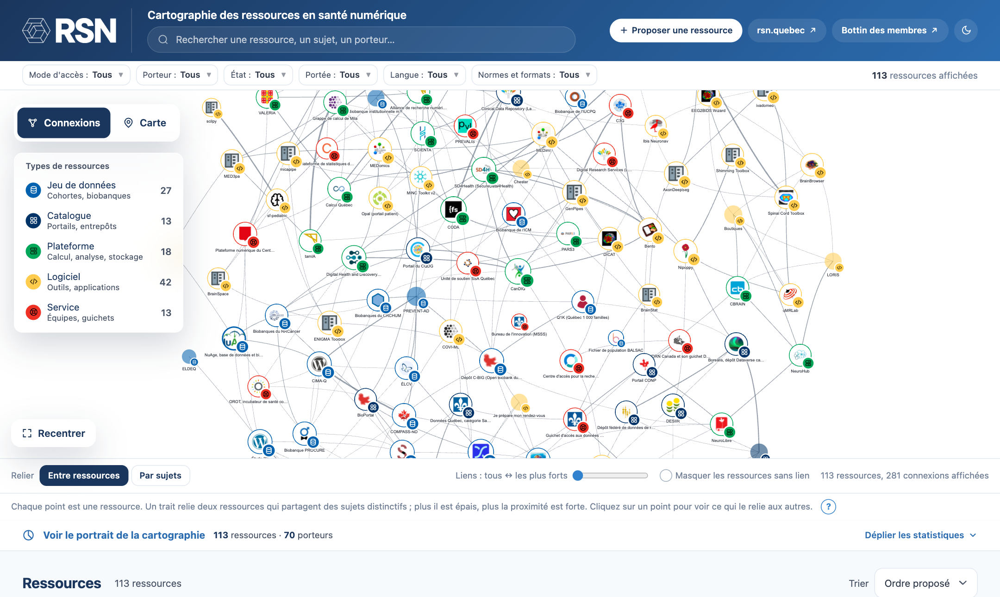
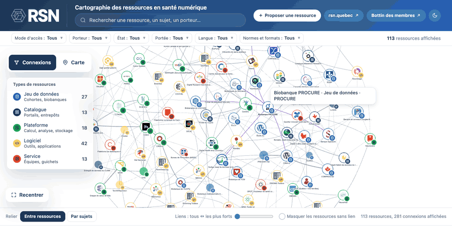
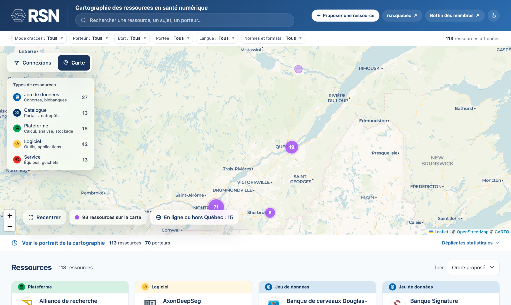
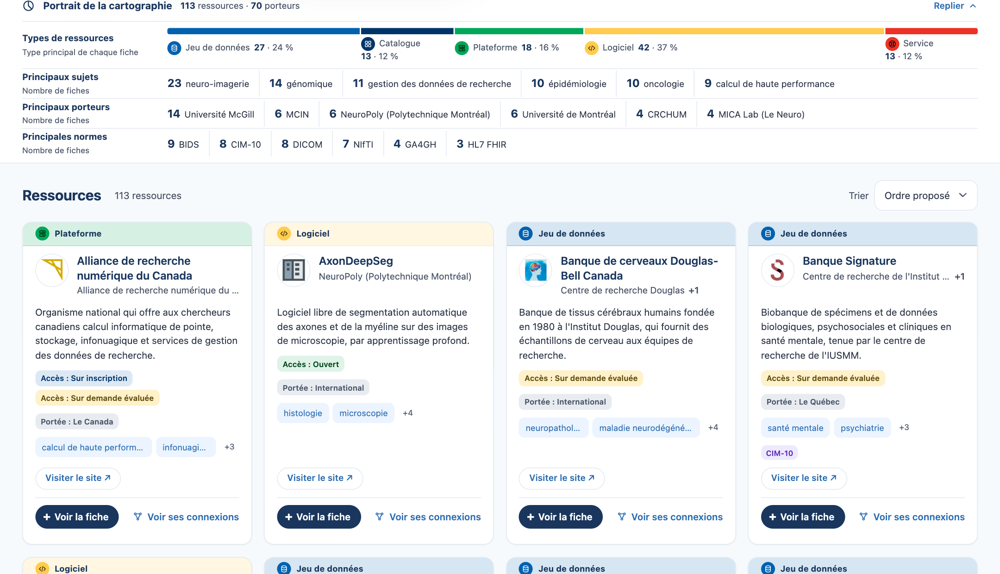
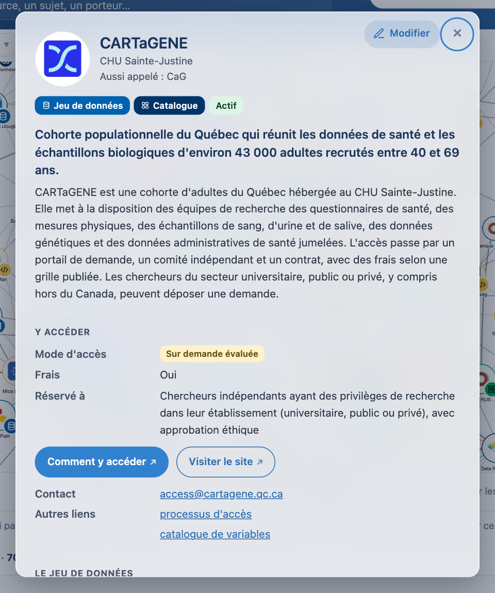

# Cartographie des ressources en santé numérique

**[cartographie.rsn.quebec](https://cartographie.rsn.quebec/)**

> *In English:* an open catalogue of digital health resources in Québec: datasets, catalogues, platforms, software and services. Each resource has a short record that says what it is for, how to get access and whom to write to. Resources appear as cards, on a map, and on a graph that links those sharing distinctive topics. Anyone can suggest a resource or a correction through a one-click email link; nothing is published until a reviewer approves it. Data lives in Notion, the site runs on Vercel, emails go through Resend. Everything below is in French; the technical section at the end lists what you need to run your own copy.

La cartographie est le catalogue public des ressources en santé numérique au Québec, tenu par le [Réseau santé numérique](https://rsn.quebec/) (RSN), un réseau de recherche québécois financé par le Fonds de recherche du Québec. Elle sert à une chose : **trouver la bonne ressource, et savoir comment y accéder**. Quelles données, quelles plateformes, quels logiciels et quels services existent, qui les porte, et à qui écrire.

Le [bottin des membres](https://bottin.rsn.quebec/) du RSN est un outil distinct, pour trouver des personnes ; son code est dans [TessRSN/Bottin](https://github.com/TessRSN/Bottin).

## Ce que l'on y trouve

### Une seule page : la recherche, les filtres, le graphe ou la carte, puis les fiches

L'accueil s'ouvre sur le graphe des connexions ; un interrupteur le remplace par la carte. À gauche, les cinq types de ressources servent de filtre : jeu de données, catalogue, plateforme, logiciel, service. La barre de recherche, dans le bandeau, comprend les noms, les sujets et les porteurs, et tolère les fautes de frappe. Six filtres à choix multiples croisent le mode d'accès, le porteur, l'état, la portée, la langue et les normes. Tout ce qui est filtré l'est partout à la fois : dans le graphe, sur la carte et dans la liste. Le site existe en mode clair et en mode sombre.



### Les connexions

Un graphe relie les ressources qui partagent des sujets distinctifs : plus deux ressources ont de sujets rares en commun, plus le trait est épais. Un clic sur une ressource efface les autres et liste celles qui lui sont reliées, avec les sujets partagés. Une seconde lecture, « Par sujets », regroupe les ressources autour des sujets les plus fréquents : neuro-imagerie, génomique, épidémiologie, et ainsi de suite. Le calcul se fait dans le navigateur, sans intelligence artificielle, à partir des mots-clés des fiches, et un bouton « ? » explique la méthode.

<p align="center"></p>

### Une carte des porteurs

Chaque ressource est placée chez l'organisation qui la porte. Les cercles comptent les ressources d'un secteur ; en zoomant, chaque porteur apparaît, et un clic liste ses ressources. Les ressources en ligne ou portées hors du Québec sont comptées à part. Sur téléphone, c'est la carte qui s'affiche en premier.



### Un portrait en chiffres, puis les fiches

Sous le graphe ou la carte, le « portrait de la cartographie » résume ce que contient le catalogue : répartition des types, principaux sujets, principaux porteurs, principales normes. Un clic sur l'un de ces chiffres filtre la cartographie. Viennent ensuite les fiches, en cartes : le type, le porteur, une phrase, le mode d'accès, la portée, les sujets et les normes.



### Une fiche mince, qui renvoie à la source

Une fiche ne cherche pas à tout dire : elle dit à quoi sert la ressource, comment y accéder et à qui écrire, puis renvoie au site de la ressource pour le reste. Le mode d'accès est toujours l'un de quatre : ouvert, sur inscription, sur demande évaluée, réservé ou interne. S'y ajoutent les frais, les personnes à qui la ressource est réservée, un contact, et selon le type : la population et la période couvertes pour un jeu de données, le dépôt de code et la licence pour un logiciel. Une ressource peut avoir deux types à la fois, par exemple une cohorte qui est aussi un catalogue.

<p align="center"></p>

### Une page par ressource, trouvable dans les moteurs de recherche

Chaque fiche a sa propre adresse, du type `cartographie.rsn.quebec/ressource/cartagene`, que l'on peut partager et que les moteurs de recherche savent lire : un titre et une description propres à la ressource, et des données structurées [schema.org](https://schema.org). Un plan du site liste ces pages.

### Des propositions relues avant publication

Tout le monde peut proposer une ressource, ou une correction à une fiche existante. La personne donne son courriel et reçoit un lien vers le formulaire, sans mot de passe. Sa proposition n'est jamais appliquée directement : elle attend dans une file, et une personne de la liste des approbateurs la relit, la corrige au besoin, puis l'approuve ou la refuse. La personne est prévenue par courriel dans les deux cas.

### Ce qui entre dans la cartographie

La règle est simple : un outil numérique en santé, qu'une équipe de recherche du Québec peut utiliser. Les organisations n'ont pas de fiche à elles : elles apparaissent comme porteurs de leurs ressources, sur la carte et dans les filtres.

## Sur quoi ça repose

| Brique | Rôle | Coût |
|---|---|---|
| [Notion](https://notion.so) | Quatre bases de données : les ressources, les porteurs, les propositions et les approbateurs. L'équipe du réseau peut y corriger une fiche sans toucher au code. | gratuit |
| [Vercel](https://vercel.com) | Héberge le site et ses sept fonctions serveur : export des fiches, pages pour les moteurs de recherche, liens par courriel, propositions, panneau d'approbation, logos, résumé hebdomadaire. Une tâche planifiée, le lundi. | gratuit, forfait Hobby |
| [Resend](https://resend.com) | Envoie les courriels : lien pour proposer ou modifier, lien d'entrée dans le panneau, réponse à une proposition, résumé hebdomadaire. | gratuit jusqu'à 100 courriels par jour |
| [Upstash](https://upstash.com) (stockage clé-valeur de Vercel) | Limite le nombre de liens envoyés et garantit qu'un lien ne sert qu'une fois. | gratuit |
| [CARTO](https://carto.com/basemaps) et [OpenStreetMap](https://www.openstreetmap.org) | Le fond de carte. CARTO avec une clé gratuite ; OpenStreetMap en repli, sans clé. | gratuit |
| [Nominatim](https://nominatim.org) (OpenStreetMap) | Transforme l'adresse d'un nouveau porteur en coordonnées pour la carte. | gratuit, usage modéré |
| [Leaflet](https://leafletjs.com), [vis-network](https://visjs.org), [Fuse.js](https://www.fusejs.io) | Bibliothèques ouvertes pour la carte, le graphe des connexions et la recherche tolérante aux fautes. | libres |
| [GitHub](https://github.com/TessRSN/cartographie-v2) | Le code, et le déploiement automatique sur Vercel à chaque changement. | gratuit |

Aucun serveur à entretenir, aucune base de données à administrer : des pages HTML sans cadriciel ni étape de compilation, des fonctions qui ne tournent qu'à la demande, et Notion comme seule source de vérité. Le code part de celui du bottin, dont il reprend les styles et le rapprochement par mots-clés.

## Comment ça marche, côté équipe

1. **Une personne propose une ressource ou une modification** avec le lien reçu par courriel. La proposition arrive dans la file, dans Notion.
2. **Une personne approbatrice ouvre le panneau d'administration**, elle aussi par un lien reçu par courriel. Elle voit la proposition à côté de la fiche actuelle, champ par champ, la corrige au besoin, puis l'approuve ou la refuse. C'est le seul chemin par lequel une proposition change une fiche publique.
3. **Le panneau sert aussi à tenir les fiches** : le tableau de toutes les ressources, la modification d'une fiche, l'ajout d'une ressource, l'historique des versions avec retour à une version d'avant, et l'export en CSV.
4. **Un résumé part chaque lundi** aux approbateurs, s'il reste des propositions en attente.
5. **Un nouveau porteur** est placé sur la carte automatiquement, à partir de son adresse.
6. **Une fiche écartée** n'est jamais publiée, et les champs internes de Notion (notes de veille, remarques, sources) ne sont jamais lus par le site.

Contact : [rsn.gestion@rimuhc.ca](mailto:rsn.gestion@rimuhc.ca).

---

## Pour installer sa propre cartographie

Cette partie s'adresse à qui veut reprendre l'outil pour un autre réseau, ou contribuer au code.

### Comment c'est fait

Des pages HTML sans cadriciel ni étape de compilation, et des fonctions hébergées chez Vercel qui lisent Notion. Le site public ne fait que lire. Les contributions (proposer une ressource ou une modification, puis l'approuver) écrivent dans Notion ; elles restent fermées tant que le réglage `CONTRIBUTIONS` ne vaut pas `oui`.

| Fichier | Rôle |
|---|---|
| `public/gabarit.html` | la page (accueil et page d'une ressource) |
| `public/css/styles.css` | les styles, repris du bottin (mêmes noms de classes) |
| `public/js/app.js` | recherche, filtres à choix multiples, bandeau de chiffres, fiches, mode clair ou sombre |
| `public/js/recherche.js` | la recherche, les suggestions et les chiffres du bandeau (fonctions pures, avec essais) |
| `public/js/carte.js`, `public/js/graphe.js` | la carte et le graphe |
| `public/js/fiche.js` | le rendu d'une fiche, commun au navigateur et au serveur |
| `public/js/texte.js` | les textes de l'interface, l'échappement, les filtres |
| `public/js/mots-cles.js`, `public/js/connexions.js` | le rapprochement des ressources par mots-clés (repris du bottin) |
| `lib/notion.js` | la lecture des bases Notion ; seul fichier qui connaît les noms de colonnes |
| `lib/fiches.js` | le passage des lignes Notion aux fiches publiques |
| `lib/page-publique.js` | les pages pour les moteurs de recherche |
| `api/export.js` | `/api/export` : les fiches publiques, en JSON |
| `api/ressource.js` | `/`, `/ressource/<adresse>`, `/sitemap.xml`, `/robots.txt` |

#### Les contributions

| Fichier | Rôle |
|---|---|
| `public/proposer.html` | le formulaire de proposition, ouvert par un lien reçu par courriel |
| `public/admin.html` | le panneau d'approbation |
| `public/js/proposer.js`, `public/js/admin.js` | le code du formulaire et du panneau |
| `public/js/champs.js` | le catalogue des champs et le calcul des changements, communs au navigateur et au serveur |
| `api/lien.js` | `/api/lien` : envoie le lien pour proposer, pour modifier une fiche ou pour entrer dans le panneau |
| `api/proposition.js` | `/api/proposition` : lit et enregistre une proposition |
| `api/admin.js` | `/api/admin` : la file des propositions, approuver, corriger, refuser |
| `api/logo.js` | `/api/logo` : sert le logo déposé pour une fiche |
| `api/resume.js` | `/api/resume` : le résumé hebdomadaire des propositions en attente, envoyé aux approbateurs le lundi |
| `lib/jetons.js` | les liens signés, valables un temps limité |
| `lib/courriels.js` | les courriels, envoyés par Resend |
| `lib/limites.js` | les limites d'envoi de liens et l'usage unique d'un lien |
| `lib/contributions.js` | ce que partagent les routes de contribution : le réglage qui les ouvre, l'origine sûre des liens |
| `lib/propositions.js` | la file des propositions et la liste des approbateurs, dans Notion |
| `lib/approbation.js` | approuver ou refuser une proposition ; le seul endroit où une fiche publique change |
| `lib/fichiers-notion.js`, `lib/images.js` | le dépôt et le contrôle des images de logo |
| `lib/geocodage.js` | les coordonnées d'un nouveau porteur, par Nominatim (OpenStreetMap) |

Une proposition n'est jamais appliquée à une fiche sans qu'une personne de la liste des approbateurs l'ait approuvée.

Une fiche dont le « Statut de la fiche » est « Écartée » n'est jamais publiée. Les champs internes de Notion (notes de veille, remarques de recherche, sources) ne sont jamais lus.

### Réglages

Variables d'environnement, dans `.env.local` en local et dans le projet Vercel en ligne. Aucune n'est dans le dépôt.

| Variable | Rôle |
|---|---|
| `NOTION_KEY` | clé de l'intégration Notion « RSN cartographie » |
| `NOTION_DB_RESSOURCES` | identifiant de la base « Ressources » |
| `NOTION_DB_PORTEURS` | identifiant de la base « Porteurs » |
| `CARTO_BASEMAP_KEY` | clé du fond de carte CARTO ; sans elle, la carte utilise OpenStreetMap |
| `INDEXATION` | `oui` pour ouvrir le site aux moteurs de recherche ; toute autre valeur le ferme |
| `SITE_URL` | adresse officielle du site ; elle sert aux pages publiques et aux liens envoyés par courriel |
| `CONTRIBUTIONS` | `oui` pour ouvrir les contributions ; toute autre valeur les ferme |
| `JWT_SECRET` | signe les liens envoyés par courriel |
| `NOTION_DB_PROPOSITIONS` | identifiant de la base « Propositions » |
| `NOTION_DB_APPROBATEURS` | identifiant de la base « Approbateurs » |
| `NOTION_DB_JOURNAL` | identifiant de la base « Journal » (qui a fait quoi dans le panneau) ; sans elle, le panneau fonctionne sans journal |
| `NOTION_DB_REGLAGES` | identifiant de la base « Réglages » (textes des courriels, mode d'essai, contributions ouvertes ou fermées et texte des conditions, réglés dans le panneau) ; sans elle, les courriels gardent leur texte d'origine, le mode d'essai suit `EMAIL_TEST_MODE`, les contributions suivent `CONTRIBUTIONS` et le formulaire garde son texte d'origine |
| `NOTION_DB_SAUVEGARDES` | identifiant de la base « Sauvegardes » (une copie complète des données chaque lundi, et à la demande depuis le panneau) ; sans elle, aucune copie n'est faite et le panneau le dit ; sa colonne texte « Changements » reçoit le résumé de ce qui a changé depuis la copie complète précédente (compteurs seulement) |
| `CRON_SECRET` | protège le déclenchement du résumé hebdomadaire ; Vercel le joint lui-même à l'appel planifié |
| `RESEND_API_KEY` | envoi des courriels ; sans elle, rien ne part et le lien est écrit dans le journal du serveur |
| `RESEND_FROM_EMAIL`, `RESEND_FROM_NAME` | expéditeur des courriels (facultatives) |
| `EMAIL_TEST_MODE`, `EMAIL_TEST_RECIPIENT` | mode d'essai : tous les courriels vont à une seule adresse ; l'Administration peut régler les deux depuis l'écran « Courriels » du panneau, qui passe alors devant ces variables |
| `KV_REST_API_URL`, `KV_REST_API_TOKEN` | stockage clé-valeur de Vercel, pour les limites d'envoi ; sans lui, une limite en mémoire prend le relais |

### En local

```bash
npm install
```

```bash
npm test
```

```bash
node --env-file=.env.local scripts/serveur-local.js
```

Le site est alors à l'adresse http://localhost:3210. Le serveur local garde la page et les réglages en mémoire : le relancer après un changement de `public/gabarit.html` ou de `.env.local`.

Attention : en local, le site lit et écrit dans les mêmes bases Notion que le site en ligne.

### Mettre à jour les logos

L'adresse du logo de chaque ressource est dans la colonne « Logo » de Notion. Le site n'affiche pas l'image depuis son site d'origine : il en sert une copie, rangée dans `public/logos/`. Après avoir ajouté ou changé un logo dans Notion :

```bash
node --env-file=.env.local scripts/copier-logos.js
```

Puis enregistrer et pousser les fichiers modifiés (`public/logos/` et `lib/logos.json`). Un logo pas encore copié est affiché depuis son adresse d'origine ; sans logo, la fiche porte une pastille avec ses initiales.

### Ouvrir le site aux moteurs de recherche

Mettre `INDEXATION=oui` dans le projet Vercel, redéployer, puis déclarer `/sitemap.xml` dans la Search Console.

## Licence

Ce projet est partagé librement pour que d'autres réseaux de recherche puissent s'en inspirer.
